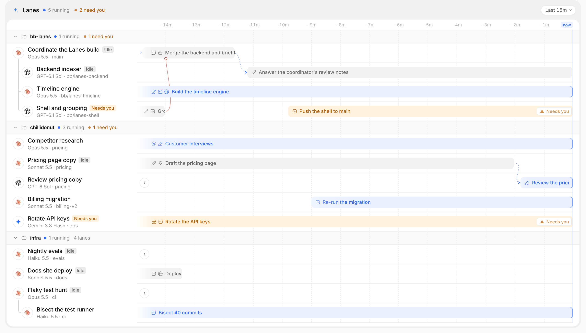
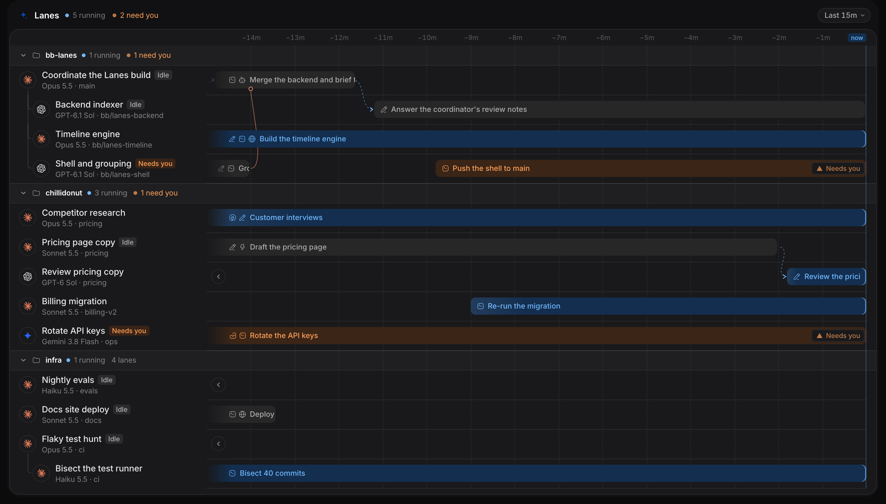
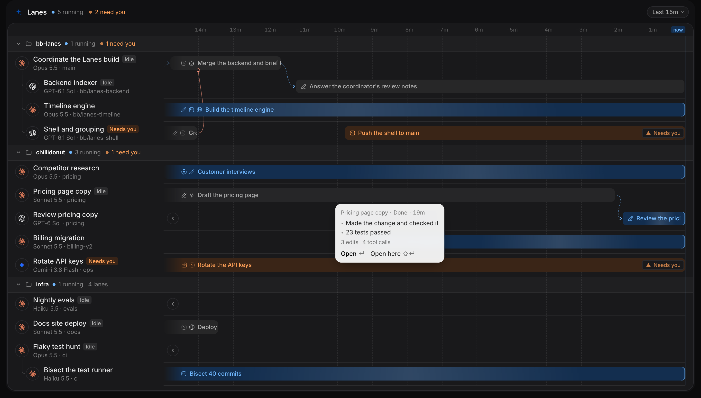
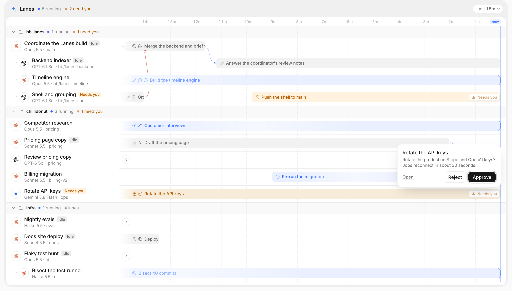
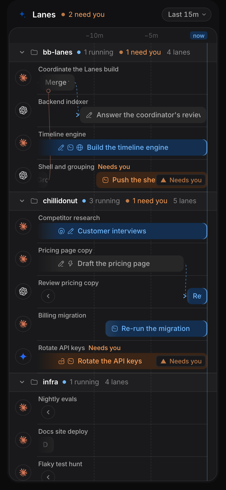

# Lanes for bb

Lanes is a [bb](https://getbb.app) plugin that shows where every agent is right
now. Each thread gets a lane on a live timeline. Each agent turn is a block
that grows towards "now" while it runs. Lines between lanes show when one agent
created, messaged, or reported back to another, and you can approve or reject
an agent's request on the block itself.





## Install

```sh
bb plugin install git:https://github.com/grrowl/bb-lanes.git
```

Then open **Lanes** from the sidebar. There is nothing to set up. The plugin
reads bb's own thread history on your bb server, keeps it in the plugin's own
storage, and needs no account or API key.

## What you get

- **A live timeline of your threads.** Lanes are grouped like the sidebar, by
  project, section, environment, machine, provider, or team, and sub-threads
  sit under the thread that started them. Threads that need you sort first.
- **Hand-off lines with one style per kind.**
  - Created is red and solid, and ends in a filled circle.
  - Messaged is blue and dashed, and ends in an arrow.
  - Ended (a child finished and bb told its parent) is red and solid, and ends
    in an open circle.
  - Forked is grey and dotted, and ends in an arrow.

  Each line leaves the sender's lane at the moment in the reply where the
  hand-off happened.
- **Detail on any turn.** Click a block for a summary of what the agent did.
  Open the thread beside Lanes, and it opens scrolled to that turn.
- **Decisions on the block.** When an agent asks for approval, approve or
  reject it from the timeline.
- **Time that moves on its own.** The window follows the clock. Scroll or drag
  back through history, pinch or ⌘-scroll to zoom from a minute to a week, and
  jump back to now. When a lane has nothing in view, a small ‹ or › button
  glides to its previous or next turn.
- **A Team lanes tab** beside any thread, showing that thread, the agents
  around it, and the threads it handed work to or from.
- **`bb lanes now`**, a short table of running and waiting turns for you or
  for an agent.





On a phone, lanes keep their names as captions, and dragging across the
timeline moves through time instead of opening bb's sidebar.



## Keyboard

| Key | Action |
| --- | --- |
| `1` to `5` | Window: 15m, 1h, 4h, 1d, 7d |
| `n` | Jump to now |
| `[` and `]` | Move back or forward in time |
| `=` and `-` | Zoom in or out |
| `g` | Group by |
| `/` | Search lanes |
| Tab, arrows, Home, End | Move between turns |
| Enter | Open a turn's detail, then open its thread beside Lanes |
| ⇧Enter | Open the thread here instead |
| Esc | Close the detail |

The keys only work while the pane has focus, and never while you type in a
field.

## Credit

The design follows affectUI's
[Agent Lanes](https://www.affectui.com/components/agent-lanes) component by
[Flo Höller](https://x.com/flohoeller), grown into a full bb pane. affectUI's
source is not included in this repository.

## Develop

```sh
npm install
npx tsc --noEmit
npx vitest run
bb plugin build
bb plugin install path:$PWD
```

`AGENTS.md` describes how we work and the opinions the plugin holds.
`SPEC.md` describes the design, and `docs/fidelity.md` records how it compares
with upstream. The code is in four parts:

| Path | What it holds |
| --- | --- |
| `server.ts`, `server/` | The indexer, storage, RPC, realtime signal, and CLI |
| `shared/` | The contracts between the server, the shell, and the timeline |
| `app.tsx`, `app/shell/` | Registration, live data, grouping, and the pane's chrome |
| `app/timeline/` | The timeline engine: time axis, blocks, lines, popovers, and motion |

`app/timeline/harness/` runs the timeline outside bb with made-up threads.
`scripts/qa/readme.mjs` takes the screenshots above from it.

## License

MIT
